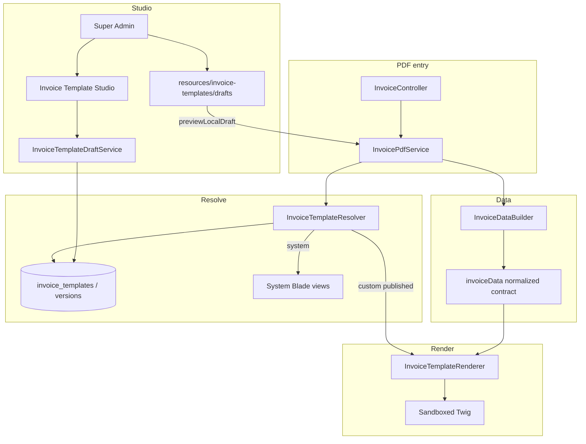

# DMC Custom Invoice Template System — Architecture

Twin of the Quotation Template System, focused on **invoice** differences. Reuses the same sandboxed Twig security stack (CSS/HTML sanitizers + Twig policy).

---

## 1. Purpose

DMCs can own branded invoice PDF layouts (proforma / final / price-only / alternate) without forking Blade views per customer.

Goals:

- Keep one **normalized `invoiceData` contract** for all custom templates.
- Keep **system Blade PDFs** as the reliable fallback.
- Allow **DMC-owned** custom HTML+CSS templates rendered via **sandboxed Twig**.
- Manage drafts in a **Super Admin–only Studio** and publish them for production PDFs.

---

## 2. How this differs from quotations

| Area | Quotation | Invoice |
|------|-----------|---------|
| Types | 2: `itinerary`, `detailed` | **5**: `proforma`, `proforma_price_only`, `final`, `final_price_only`, `alternate` |
| Preview key | `tour_id` | **`tour_id` (preferred)**; optional `invoice_id` |
| PDF seam | `CommonHelper::streamOrDownloadQuotationPdf` | **`InvoicePdfService::streamOrDownload`** |
| Data builder | `QuotationDataBuilder` (+ itinerary/detailed) | **`InvoiceDataBuilder`** |
| Auto create | n/a | **`InvoiceService::ensureInvoiceForTour`** after Prospect (`TourInvoiceObserver`) |
| Local drafts | `resources/quotation-templates/drafts/` | `resources/invoice-templates/drafts/` |
| Studio routes | `/quotation-templates` | `/invoice-templates` |
| CLI | `quotation-template:check-draft --tour=` | `invoice-template:check-draft --tour=` |
| Relations for branding | tour → dmc / agent | invoice → **`agent.agency`**, dmc, items |

Post-Prospect invoice rules:

- Status must be `Tentative`, `Confirmed`, `Definite`, or `Actual` (not Prospect / New Enquiry).
- `Tentative` / `Confirmed` → ensure **proforma** exists.
- `Definite` / `Actual` → ensure **final** (convert proforma if needed).
- Published DMC HTML/CSS templates apply at **PDF render** time (not at create).

Axes → type mapping: `InvoiceTemplateResolver::typeFromAxes(invoice_type, mode, format)`.

- Mode `full` → `proforma` / `final`
- Mode `price-only` → `*_price_only`
- Format `alternate` → `alternate` (regardless of mode)

---

## 3. High-level flow



---

## 4. Template types & default Blade views

| `invoice_type` | Label | Default view |
|----------------|-------|--------------|
| `proforma` | Proforma Invoice | `invoices.pdf.proforma` |
| `proforma_price_only` | Proforma (Price Only) | `invoices.pdf.proforma-price-only` |
| `final` | Final Invoice | `invoices.pdf.final` |
| `final_price_only` | Final (Price Only) | `invoices.pdf.final-price-only` |
| `alternate` | Alternate Layout | `invoices.pdf.alternate` |

Ownership: one row per `(dmc_id, invoice_type)`. Branding mode (`dmc` / `agency`) is data-only (`branding.mode` / `logoType`).

---

## 5. Studio & local draft preview

| Piece | Detail |
|-------|--------|
| Auth | `EnsureSuperAdmin` (`super.admin`) |
| Controller | `Admin\InvoiceTemplateStudioController` |
| Services | `InvoiceTemplateDraftService`, `InvoiceTemplatePublishService` |
| UI | `resources/views/admin/invoice-templates/*` |
| Nav | Sidebar **Invoice Templates** (Super Admin) |

**Local draft preview** (`invoice_id` required):

1. Load `Invoice::with(['tour','agent.agency','dmc','items'])`.
2. Assert `invoice.dmc_id` matches Studio `dmc_id` when provided.
3. Build currency context via CommonHelper (same helpers as `InvoiceController::buildInvoiceCurrencyContext`).
4. Derive mode (`full` / `price-only`) and call `InvoicePdfService::previewLocalDraft(...)`.

Draft file basenames: `proforma`, `proforma-price-only`, `final`, `final-price-only`, `alternate`.

---

## 6. Normalized `invoiceData` (Twig variables)

| Key | Kind |
|-----|------|
| `invoice` | object — number, dates, type, mode |
| `branding` | object — company_name, logo, address, … |
| `client` | object |
| `travel_company` | object |
| `travel` | object |
| `items` | list |
| `pricing` | object — `total_amount`, currencies, taxes, … |
| `bank_details` | array |
| `payment_terms` | array |
| `terms_and_conditions` | scalar |
| `notes` | object |
| `tour` | object |
| `presentation` / `template` | meta |

Example:

```twig
<h1>{{ branding.company_name|default('Invoice') }}</h1>
<p>{{ invoice.number }} — {{ pricing.total_amount|default(0)|number_format(2) }}</p>

  <p>{{ item.description }}</p>

```

---

## 7. Operator workflow

1. Edit `resources/invoice-templates/drafts/proforma.html` (+ `.css`).
2. Preview with a real invoice:
   - Studio → **Check local draft** → Invoice ID → HTML/PDF
   - or `php artisan invoice-template:check-draft proforma --invoice=ID [--pdf]`
3. Copy into Studio → **Save Draft** → **Publish**.

Output files: `storage/app/invoice-template-drafts/`.

---

## 8. File map

```
app/Models/InvoiceTemplate.php
app/Models/InvoiceTemplateVersion.php
app/Services/Invoices/
  InvoiceDataBuilder.php
  InvoicePdfService.php
  InvoiceTemplateResolver.php
  InvoiceTemplateRenderer.php
  InvoiceTemplateDraftService.php
  InvoiceTemplatePublishService.php
  *Exception.php
app/Http/Controllers/Admin/InvoiceTemplateStudioController.php
app/Console/Commands/CheckInvoiceTemplateDraft.php
resources/views/admin/invoice-templates/
resources/invoice-templates/drafts/
database/migrations/2026_11_04_180000_create_invoice_template_tables.php
docs/invoice-template-system/ARCHITECTURE.md   # this file
```

Security and draft versioning rules match the quotation system (sandbox Twig, Super Admin only, draft ≠ live until publish).
