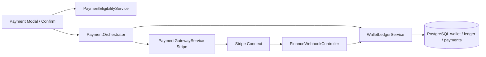

# Travclicks Payment Service — Architecture (Laravel-only)

**Date:** 2026-10-14  
**Engine:** Laravel `WalletLedgerService` + PostgreSQL `public.wallet*`  
**Gateway:** Stripe Connect (Razorpay removed; Python microservice removed)

See [OPERATIONS.md](./OPERATIONS.md) for env setup and [IMPLEMENTATION_PLAN.md](./IMPLEMENTATION_PLAN.md) for checklist.

## Stack

## Recipient routing

| Stage | Card | Application fee |
|-------|------|-----------------|
| `supplier_initial` (Online / Mix-1) | Travclicks platform PI | none |
| `dmc_collection` (Offline / Mix-2) | Destination → DMC | Travclicks markup / percent |

## Wallet

Agent spend is DMC-scoped via `wallet.source_dmc_id`. Reserve → commit/release for supplier-initial flows.
