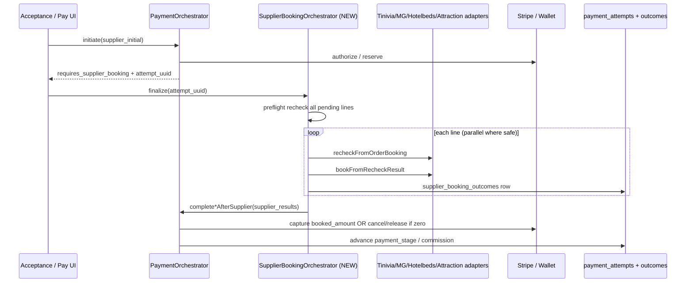

# Supplier Booking Orchestration — Architecture

**Date:** 2026-11-18  
**Status:** Design (not implemented)  
**Depends on:** [ARCHITECTURE.md](./ARCHITECTURE.md), existing `PaymentOrchestrator`, `OnlineHotelBookingService`*, attraction online order services  
**Goal:** One user click pays/authorizes the **online portion** of a tour, then books **every** pending online hotel/attraction across vendors, then captures only what succeeded.

---

## 1. Decision (locked)

| Choice | Decision |
|--------|----------|
| Payment granularity | **One** `supplier_initial` payment attempt per tour (all online items) |
| Booking granularity | **One line per** `(order_id, booking_index)` — vendor APIs stay item-level |
| UX | One click: authorize → book all → settle |
| Partial success | Capture/commit booked amount only; failed lines retry without a new full tour payment |
| Manual approve modal | Ops / fallback only — not the primary finalize path |

Do **not** create one Stripe/wallet payment per hotel.

---

## 2. Fit with the existing system



### Existing pieces to reuse (do not reinvent)

| Piece | Role today | Role after |
|-------|------------|------------|
| `AcceptanceFlowService` | `pay_online` / Mix gate | Unchanged |
| `OrderClassificationService` | online amount + stage | Source of payable online total |
| `PaymentOrchestrator::initiate` | Creates attempt; Stripe **manual** capture / wallet reserve | Unchanged |
| `completeStripeAfterSupplier` / `completeWalletAfterSupplier` | Capture from `supplier_results` | Called **once** with real results from SBO |
| `supplier_booking_outcomes` | Audit sink (partially used) | Primary per-line ledger |
| `OnlineHotelBookingService` | Per-hotel recheck/book | Called by SBO, not by UI loop |
| `OnlineAttractionOrderService` | Attraction voucher/book | Same — adapter behind a common line interface |
| `openPendingOnlineHotelApprovalsAfterPay` | Sequential modals after pay | Demote to fallback / retry UI |

### Gap today

Frontend often posts `supplier_results: []`, then opens approve modals. Money can settle **before** supplier books (or without outcomes). Orchestration must run **between** auth and capture.

---

## 3. Component design

### 3.1 `SupplierBookingOrchestrator` (new)

Location: `app/Services/Payment/SupplierBookingOrchestrator.php`

Responsibilities:

1. Build **booking plan** for a tour + payment attempt (pending online hotels + attractions).
2. **Preflight** recheck all lines (fail-fast on hard unavailability / catastrophic price spikes if policy requires).
3. **Execute** bookings with idempotency, timeouts, per-vendor concurrency limits.
4. Persist each line to `supplier_booking_outcomes` (+ optional run header).
5. Map outcomes → `supplier_results[]` shape expected by `PaymentOrchestrator`.
6. Call `completeStripeAfterSupplier` / `completeWalletAfterSupplier`.
7. Return a **finalize report** for the UI.

Non-responsibilities:

- Creating PaymentIntents / wallet reserves (stays in `PaymentOrchestrator`)
- Vendor-specific payload shaping (stays in Tinivia/MG/Hotelbeds/Attraction services)
- Offline negotiation / DMC collection

### 3.2 `SupplierBookingLineResolver` (new)

Scans tour orders and emits normalized lines:

```
tour_id + order_id + booking_index + service_type + supplier_code
```

Rules:

- Include only `order_type = online` (or equivalent attraction flags).
- Skip already approved / already supplier-booked lines (idempotent re-finalize).
- Hotel index must match `HotelBookingController` ordering (`type=hotel`, not deleted, `orderBy id`).
- Attraction lines use the same order row + booking index contract as approve/voucher flows.

### 3.3 Common line executor interface (new)

```php
interface SupplierBookableLine
{
    public function identity(): SupplierLineId; // tour, order, index, type
    public function supplierCode(): string;
    public function quotedAmount(): float;
    public function currency(): string;

    /** Live availability + price; may throw or return failed status. */
    public function recheck(array $options = []): SupplierRecheckResult;

    /** Book using recheck result + stable agency reference. */
    public function book(SupplierRecheckResult $recheck, string $agencyBookingId): SupplierBookResult;
}
```

Adapters:

- `OnlineHotelBookableLine` → `OnlineHotelBookingServiceFactory`
- `OnlineAttractionBookableLine` → `OnlineAttractionOrderService`

---

## 4. Data structures (flawless booking)

### 4.1 Stable line identity (critical)

Every online item must have an immutable identity for the life of the tour:

| Field | Type | Why |
|-------|------|-----|
| `tour_id` | int | Scope |
| `order_id` | int | `orders.id` |
| `booking_index` | int | Position inside `orders.data` array |
| `service_type` | `hotel` \| `attraction` | Executor routing |
| `supplier_code` | string | `tinivia` / `mg_bedbank` / `hotelbeds` / attraction code |

**Idempotency key** (unique, never reused for a different book attempt intent):

```
sbo:{payment_attempt_uuid}:{service_type}:{order_id}:{booking_index}
```

If a line is retried under the **same** payment attempt, reuse the same key.  
If a **new** payment attempt is created (rare recovery), use a new key.

### 4.2 New table: `supplier_booking_runs` (saga header)

One row per finalize attempt linked to a payment attempt.

| Column | Type | Notes |
|--------|------|-------|
| `id` | bigint PK | |
| `run_uuid` | uuid unique | Public id |
| `payment_attempt_id` | FK → payment_attempts | Required |
| `tour_id` | bigint indexed | |
| `status` | string | see state machine |
| `phase` | string | `preflight` / `booking` / `settling` / `done` |
| `quoted_total` | decimal(18,4) | Sum of lines at plan time |
| `booked_total` | decimal(18,4) | Sum of successful books |
| `currency_code` | char(3) | Tour/online currency |
| `line_count` | int | |
| `booked_count` | int | |
| `failed_count` | int | |
| `uncertain_count` | int | Supplier timeout / unknown |
| `preflight_snapshot` | json | Plan + recheck summaries |
| `settle_snapshot` | json | What was sent to complete*AfterSupplier |
| `started_at` / `finished_at` | timestamps | |
| `last_error` | text nullable | |

**Run status machine**

```
created → preflighting → booking → settling → completed
                              ↘ partial
                              ↘ failed          (nothing booked; PI cancelled / wallet released)
                              ↘ needs_reconciliation  (uncertain supplier outcomes)
```

### 4.3 Extend `supplier_booking_outcomes` (line ledger)

Existing table is the right sink; add columns for orchestration:

| Column | Type | Notes |
|--------|------|-------|
| `run_id` | FK nullable | Link to `supplier_booking_runs` |
| `booking_index` | int nullable | Required for hotels/attractions in data[] |
| `service_type` | string(20) | `hotel` / `attraction` |
| `supplier_code` | string(64) | Explicit vendor |
| `idempotency_key` | string(160) unique | Section 4.1 |
| `line_status` | string(32) | finer than generic `status` if needed |
| `agency_booking_id` | string(128) | What we sent as client/agency ref |
| `recheck_token` | string(128) nullable | Cache token from vendor service |
| `quoted_amount` | already exists | Preflight quote |
| `booked_amount` | already exists | Post-book |
| `request_meta` / `response_meta` | json | Keep vendor payloads (redact secrets) |
| `attempt_no` | int default 1 | Retry count within run |
| `booked_at` | timestamp nullable | |

**Line statuses** (store in `status` or `line_status`):

| Status | Meaning | Money |
|--------|---------|-------|
| `pending` | Planned, not started | — |
| `rechecking` | Live recheck in flight | — |
| `ready` | Recheck OK, bookable | — |
| `booking` | Book API in flight | — |
| `booked` | Supplier confirmed | Include in capture |
| `failed` | Soft fail (unavailable, validation) | Exclude |
| `uncertain` | Timeout / ambiguous response | **Do not auto-retry book**; reconcile |
| `skipped` | Already booked earlier | Exclude from new capture delta |

Unique constraint: `idempotency_key`.  
Secondary unique (optional): `(payment_attempt_id, order_id, booking_index, service_type)`.

### 4.4 In-memory / API DTOs

#### Booking plan

```json
{
  "tour_id": 12345,
  "payment_attempt_uuid": "...",
  "currency": "SGD",
  "lines": [
    {
      "order_id": 901,
      "booking_index": 0,
      "service_type": "hotel",
      "supplier_code": "tinivia",
      "label": "Marina Bay Sands — Deluxe",
      "quoted_amount": 420.00,
      "idempotency_key": "sbo:...:hotel:901:0"
    }
  ],
  "quoted_total": 890.50
}
```

#### `supplier_results` passed into `PaymentOrchestrator` (must match current consumer)

```json
[
  {
    "order_id": 901,
    "status": "booked",
    "quoted_amount": 420.00,
    "booked_amount": 420.00,
    "currency_code": "SGD",
    "supplier_api_id": "tinivia",
    "supplier_booking_reference": "TNV-99881",
    "request_meta": { "booking_index": 0, "service_type": "hotel" },
    "response_meta": { "booked_at": "..." },
    "error_message": null
  },
  {
    "order_id": 902,
    "status": "failed",
    "quoted_amount": 150.00,
    "booked_amount": 0,
    "currency_code": "SGD",
    "supplier_api_id": "hotelbeds",
    "error_message": "No availability"
  }
]
```

`CommissionBreakdownService` / `persistSupplierOutcomes` already key off `status === booked` and `order_id`.

#### Finalize report (UI)

```json
{
  "run_uuid": "...",
  "payment_attempt_uuid": "...",
  "run_status": "partial",
  "captured_amount": 420.00,
  "quoted_total": 890.50,
  "lines": [
    { "order_id": 901, "status": "booked", "reference": "TNV-99881" },
    { "order_id": 902, "status": "failed", "error": "No availability", "retryable": true }
  ],
  "next_actions": ["retry_failed_lines", "continue_mix_negotiation"]
}
```

### 4.5 Agency / client booking reference

Vendors require a client booking id (Tinivia `bookingId`, etc.).

Generate **deterministically** so retries do not mint a new supplier reservation:

```
{tour_display_id|tour_id}-O{order_id}-B{booking_index}
```

Persist as `agency_booking_id` on the outcome before calling `bookFromRecheckResult`.  
Do **not** require the agent to type Reference ID for online lines (already hidden in approve modal).

### 4.6 Recheck cache contract

Keep using each vendor service’s `cacheRecheckResult` / `pullCachedRecheckResult`, but:

- Orchestrator owns the token in `supplier_booking_outcomes.recheck_token`
- TTL short (existing ~20 min); **always re-recheck inside the same run** if token missing
- On successful book → `forgetCachedRecheckResult`
- Never book a recheck from a **different** payment attempt

---

## 5. Runtime algorithm

### Phase A — Preflight (before or immediately after auth)

1. Lock tour finalize (redis lock `sbo:tour:{tour_id}`).
2. Resolve pending lines.
3. Parallel recheck (concurrency cap, e.g. 5).
4. Policy gates:
   - Hard unavailable → mark `failed`, optionally abort whole run if `all_or_nothing` flag (default **off**).
   - Price change beyond threshold → mark needs confirmation or fail line (product policy).
5. Persist preflight snapshot on the run.

### Phase B — Book

1. For each `ready` line (parallel by default; serialize only if same supplier session requires it):
   - Transition `booking`
   - Call `book(...)` with deterministic `agency_booking_id`
   - On success → `booked` + reference
   - On clear failure → `failed`
   - On timeout / unknown → `uncertain` (**never** blind retry book)
2. Write outcomes continuously (crash-safe).

### Phase C — Settle money

Build `supplier_results` from this run’s outcomes →  
`completeStripeAfterSupplier` / `completeWalletAfterSupplier`:

| Outcomes | Money action (already in orchestrator) |
|----------|----------------------------------------|
| All failed / none booked | Cancel PI / release wallet |
| Some booked | Capture/commit **booked_total** |
| Uncertain present | Prefer `needs_reconciliation`; do not double-book |

### Phase D — Advance tour

Reuse `advanceAcceptance`:

- ONLINE → `dmc_collection` / confirmed path as today when online settled
- MIX → `offline_negotiation` when online portion settled

Failed lines remain unapproved; UI offers **Retry failed online items** (same attempt if auth still open, or residual auth/new attempt for remaining amount only).

---

## 6. Concurrency, idempotency, failure modes

| Concern | Rule |
|---------|------|
| Double click Pay | `payment_attempts.idempotency_key` + run unique on `payment_attempt_id` |
| Double book same hotel | Unique `idempotency_key` on outcomes; skip if `booked` |
| Partial vendor outage | Book others; capture partial; retry failed |
| Uncertain book | Manual reconcile; check supplier portal/API before retry |
| Process crash mid-run | Resume from outcomes: skip `booked`, retry `ready`/`failed`, investigate `uncertain`/`booking` |
| Order data mutation during run | Reject finalize if order `updated_at` / content hash ≠ plan snapshot |

---

## 7. API surface (suggested)

| Method | Route | Purpose |
|--------|-------|---------|
| POST | `/payment-service/tours/{tourId}/finalize-online` | Auth already done → run SBO + complete |
| POST | `/payment-service/tours/{tourId}/finalize-online/retry` | Retry failed lines for attempt/run |
| GET | `/payment-service/tours/{tourId}/supplier-booking-runs/{runUuid}` | Poll status |

Keep Stripe card confirm on the client; move **booking** off the client.

Replace:

```js
supplier_results: []
openPendingOnlineHotelApprovalsAfterPay()
```

with:

```js
await finalizeOnline(tourId, attemptUuid) // server books all vendors
```

---

## 8. Implementation phases

1. **Schema** — `supplier_booking_runs` + outcome columns + unique idempotency
2. **Resolver + DTOs** — plan builder for hotels + attractions
3. **Orchestrator** — preflight → book → `complete*AfterSupplier`
4. **Wire UI** — acceptance pay path calls finalize; remove primary modal queue
5. **Retry + reconciliation UI** — failed/uncertain lines
6. **Keep** existing approve modal as Super-Admin/ops escape hatch

---

## 9. Explicit non-goals

- One payment intent per hotel  
- Distributed 2PC across Stripe + Tinivia + MG  
- Auto-cancelling a successful supplier booking because another line failed  
- Changing offline / Mix negotiation money rules

---

*Document version: design for one-click multi-vendor online finalize on top of PaymentOrchestrator.*
