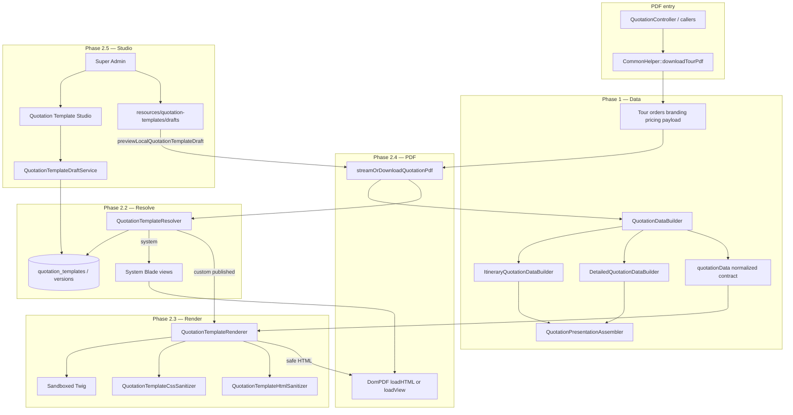
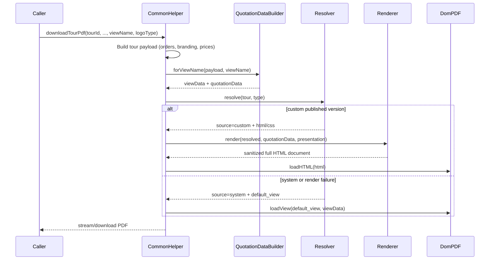
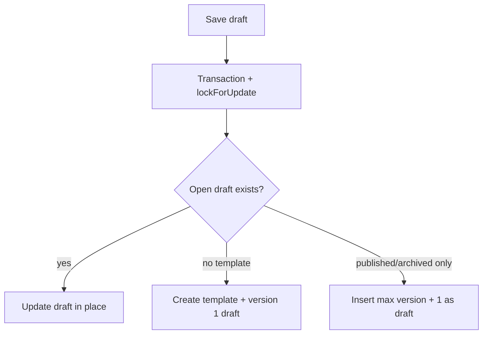

# DMC Custom Quotation Template System — Architecture

Complete architecture and operator documentation for the DMC-specific Custom Quotation Template System as implemented through **Phase 2.5** (plus local draft preview tooling).

---

## 1. Purpose

DMCs can eventually own branded quotation PDF layouts (Acco+Service / Detailed) without forking Blade views per customer.

Goals:

- Keep one **normalized quotation data contract** for all templates.
- Keep **system Blade PDFs** as the reliable fallback.
- Allow **DMC-owned** custom HTML+CSS templates rendered via **sandboxed Twig**.
- Enforce security: no PHP/Blade execution, no remote resources, strict HTML/CSS allowlists.
- Manage drafts in a **Super Admin–only Studio** and publish them for production PDFs.

Non-goals (still backlog):

- Rollback / active-version switching UI (without republishing a draft)
- In-Studio live preview of DB drafts
- DMC- or agent-facing editors
- Template marketplace / sharing

---

## 2. High-level architecture



---

## 3. Ownership and branding model

| Concept | Rule |
|--------|------|
| Template owner | **DMC** = `users.userId` where `user_type = 2` and `role_id = 11` |
| Agents | Do **not** own templates; never used as ownership keys |
| Quotation types | One template row per `(dmc_id, quotation_type)` |
| Types | `itinerary` (UI label: **Acco+Service Quotation**), `detailed` (**Detailed Quotation**) |
| Branding modes | `dmc` / `agency` live in **data** (`branding.mode`), not as separate template ownership records |
| System defaults | Blade views in app code; not stored in DB |

---

## 4. Phase map (what exists)

| Phase | Status | Responsibility |
|-------|--------|----------------|
| **1** | Done | Normalized data builders + Blade presentation reuse |
| **2.1** | Done | DB tables + Eloquent models |
| **2.2** | Done | Resolver (custom published vs system) |
| **2.3** | Done | Secure Twig renderer + HTML/CSS sanitizers |
| **2.4** | Done | PDF integration (`loadHTML` / Blade fallback) |
| **2.5** | Done | Super Admin Studio + draft versioning |
| Draft preview | Done | Local file preview with real tour data (no DB write) |
| **2.6** | Partial | Publish draft → active version (Studio). Rollback / DB draft preview still backlog |

---

## 5. Component catalog

### 5.1 Data layer (Phase 1)

| Class | Path | Role |
|-------|------|------|
| `QuotationDataBuilder` | `app/Services/Quotations/QuotationDataBuilder.php` | Merges helper payload + presentation; builds `quotationData` |
| `ItineraryQuotationDataBuilder` | same folder | Acco+Service share-row presentation |
| `DetailedQuotationDataBuilder` | same folder | Detailed quotation presentation |
| `QuotationPresentationAssembler` | same folder | Shared pricing/occupancy/country assembly |

Entry: `CommonHelper::downloadTourPdf()` builds the raw payload, then `streamOrDownloadQuotationPdf()` calls `QuotationDataBuilder::forViewName()`.

### 5.2 Persistence (Phase 2.1)

**Tables**

`quotation_templates`

| Column | Notes |
|--------|--------|
| `id` | PK |
| `dmc_id` | FK → `users.userId` |
| `quotation_type` | `itinerary` \| `detailed` |
| `active_version_id` | Nullable FK → published version used at PDF time |
| Unique | `(dmc_id, quotation_type)` |

`quotation_template_versions`

| Column | Notes |
|--------|--------|
| `quotation_template_id` | FK |
| `version` | Integer; unique per template |
| `html_content` / `css_content` | Raw Twig HTML + CSS (executed only via sandbox at render) |
| `status` | `draft` \| `published` \| `archived` |
| `change_notes` | Optional |
| `created_by` | Super Admin `userId` |
| `published_at` | Set on publish (Phase 2.6) |

**Models:** `App\Models\QuotationTemplate`, `App\Models\QuotationTemplateVersion`  
**Migration:** `database/migrations/2026_11_02_161000_create_quotation_template_tables.php`

### 5.3 Resolver (Phase 2.2)

`QuotationTemplateResolver::resolve(Tour $tour, string $quotationType)`

- DMC ID from **tour → dmc relationship only** (never request/agent IDs).
- Custom only if `active_version_id` points to a **published** version belonging to that template with non-empty HTML.
- Otherwise returns `source = system` with `default_view`:
  - itinerary → `single-tour-package.quotation`
  - detailed → `single-tour-package.detailedqutation`

### 5.4 Renderer & security (Phase 2.3)

| Class | Role |
|-------|------|
| `QuotationTemplateRenderer` | Twig sandbox, autoescape, strict variables |
| `QuotationTwigSecurityPolicy` | Deny unsafe tags/filters/functions |
| `QuotationTemplateCssSanitizer` | Allowlisted CSS; blocks imports/urls/expressions/breakout |
| `QuotationTemplateHtmlSanitizer` | Element/attribute allowlist; data-URI image validation; final document wrap |
| `QuotationTemplateRenderException` | Safe render failures → PDF Blade fallback |
| `SystemQuotationTemplateFallbackException` | System source must not be Twig-rendered |

**Allowed Twig**

- Tags: `if`, `for`, `set`
- Filters: `escape`, `e`, `default`, `abs`, `capitalize`, `date`, `first`, `last`, `join`, `length`, `lower`, `upper`, `trim`, `nl2br`, `replace`, `round`, `slice`, `sort`, `keys`, `batch`, `column`, `number_format`, `merge`, `title`, `striptags`
- Functions: `min`, `max`, `range`, `date`

**Allowed HTML elements (body content):**  
`div`, `span`, `p`, `h1`–`h6`, `table`/`thead`/`tbody`/`tfoot`/`tr`/`th`/`td`, `ul`/`ol`/`li`, `strong`/`b`/`em`/`i`/`u`, `img`, `hr`, `br`  
(Not allowed: `header`, `section`, `a`, `script`, forms, iframes, SVG, etc.)

**DomPDF:** `enable-php = false`, `isRemoteEnabled = false`.

### 5.5 PDF seam (Phase 2.4)

Only `CommonHelper::streamOrDownloadQuotationPdf()`:

1. Enrich view data via `QuotationDataBuilder`.
2. Resolve template for tour + type.
3. If custom → render Twig → `Pdf::loadHTML`.
4. On system source or render failure → `Pdf::loadView(default_view)`.
5. Finalize paper/security options; stream or download.

GD/logo retry behavior is preserved.

### 5.6 Studio (Phase 2.5)

| Piece | Detail |
|-------|--------|
| Auth | `EnsureSuperAdmin`: `user_type === 1` **and** `role_id === 1` |
| Middleware alias | `super.admin` |
| Controller | `Admin\QuotationTemplateStudioController` |
| Service | `QuotationTemplateDraftService` |
| UI | `resources/views/admin/quotation-templates/*` |
| Nav | Sidebar link for Super Admin only |

**Routes**

| Method | URI | Name |
|--------|-----|------|
| GET | `/quotation-templates` | `quotation-templates.index` |
| GET | `/quotation-templates/{dmcId}/{type}` | `quotation-templates.show` |
| POST | `/quotation-templates/{dmcId}/{type}` | `quotation-templates.store` |
| PUT | `/quotation-templates/{dmcId}/{type}/draft` | `quotation-templates.draft.update` |
| GET | `/quotation-templates/{dmcId}/{type}/versions/{version}` | `quotation-templates.versions.show` |
| GET | `/quotation-templates/drafts/{name}/preview` | `quotation-templates.drafts.preview` |
| GET | `/quotation-templates/drafts/{name}/pdf` | `quotation-templates.drafts.pdf` |

### 5.7 Local draft files (pre-save check)

| Path | Role |
|------|------|
| `resources/quotation-templates/drafts/acco-service.html/.css` | Acco+Service working files |
| `resources/quotation-templates/drafts/detailed.html/.css` | Detailed working files |
| `php artisan quotation-template:check-draft` | CLI validate/render |
| `CommonHelper::previewLocalQuotationTemplateDraft()` | Request-scoped override; same payload as PDF; **no DB template read/write** |

---

## 6. Runtime PDF sequence



---

## 7. Normalized `quotationData` contract

Built by `QuotationDataBuilder::toNormalizedContract()`. Templates should use these keys (plain arrays/scalars only):

| Key | Kind | Typical contents |
|-----|------|------------------|
| `quotation` | object | `reference`, `date`, `valid_until`, `currency`, `base_currency`, `exchange_rate`, `type`, `generated_at` |
| `branding` | object | `mode`, `company_name`, `logo`, `address`, `email`, `phone`, `dmc_details`, `agent_details` |
| `booking` | object | guest counts, `lead_guest_name`, `pax_text`, passengers, FOC flags |
| `travel` | object | destination, dates, duration, rooming text |
| `services` | object | `by_type`, `by_date`, hotels/other by country, country meta *(orders stripped in renderer)* |
| `pricing` | object | occupancy totals, discounts, tax, `subtotal`, `grand_total`, package rows, supplements |
| `bank_details` | array | bank rows |
| `terms_and_conditions` | scalar | HTML/text string |
| `exclusions` | scalar | |
| `quotation_information` | scalar | |
| `presentation` | object | Explicitly approved extras only (e.g. logoType, currencies) |
| `template` | object | Meta from resolver (`identifier`, version, type) |

**Important:** Templates use **Twig**, not Blade/PHP. Do not invent filters or tags outside the allowlist.

Example:

```twig
<h1>{{ branding.company_name|default('Quotation') }}</h1>
<p>{{ booking.lead_guest_name }} — {{ quotation.reference }}</p>
<p>{{ pricing.grand_total|default(0)|number_format(2) }} {{ pricing.display_currency }}</p>

  <p>{{ hotel.name }}</p>

```

---

## 8. Draft versioning policy (Studio)



Rules:

1. At most one template per DMC + type.
2. Saving never changes `active_version_id`.
3. Published/archived rows are never mutated by draft save.
4. `created_by` always from authenticated Super Admin (client values ignored).
5. Limits: HTML ≤ 500 000 chars, CSS ≤ 200 000, notes ≤ 2000; empty HTML rejected.
6. Opening Studio **does not** create DB rows.

Until a draft is **Published** in Studio (sets `status=published` and `active_version_id`), production PDFs continue to use **system Blade**.

---

## 9. Security model

| Layer | Control |
|-------|---------|
| Studio access | Super Admin only (`user_type=1` + `role_id=1`) |
| DMC selection | Queried as real DMC users; path `dmcId` validated |
| CSRF | Web middleware on mutating Studio routes |
| Template execution | Twig sandbox only; never `eval`/Blade/PHP on save |
| HTML/CSS | Sanitizers + allowlists; no remote CSS/images |
| Images | Validated data URIs only (PNG/JPEG/GIF, size capped) |
| DomPDF | PHP disabled; remote disabled |
| Logging | Avoid logging full template bodies |
| Studio display | Metadata escaped; template HTML never `{!! !!}` executed in admin UI |
| PDF ownership | Resolver uses tour DMC only |

---

## 10. Operator workflows

### 10.1 Develop a template safely

1. Edit `resources/quotation-templates/drafts/acco-service.html` (+ `.css`) or `detailed.*`.
2. Preview with a real tour (same data as PDF):
   - Studio → **Check local draft before saving** → Tour ID → HTML/PDF preview  
   - or CLI: `php artisan quotation-template:check-draft acco-service --tour=TOUR_ID [--pdf]`
3. Fix Twig/HTML until preview matches expectations.
4. Copy file contents into Studio editors → **Save Draft**.
5. Click **Publish draft** in Studio so the resolver selects it for enquiry PDFs.

### 10.2 CLI reference

```bash
# Sample fixture data only
php artisan quotation-template:check-draft acco-service

# Real tour quotation payload
php artisan quotation-template:check-draft acco-service --tour=12345
php artisan quotation-template:check-draft acco-service --tour=12345 --pdf --currency=USD --logo-type=dmc
php artisan quotation-template:check-draft detailed --type=detailed --tour=12345
```

Output files: `storage/app/quotation-template-drafts/`.

### 10.3 Tests

```bash
php vendor/bin/phpunit tests/Unit/Quotations
```

Coverage includes data builders, models, resolver, renderer security, PDF integration, draft service, and Studio authorization.

---

## 11. File map

```
app/Models/QuotationTemplate.php
app/Models/QuotationTemplateVersion.php
app/Services/Quotations/
  QuotationDataBuilder.php
  ItineraryQuotationDataBuilder.php
  DetailedQuotationDataBuilder.php
  QuotationPresentationAssembler.php
  QuotationTemplateResolver.php
  QuotationTemplateRenderer.php
  QuotationTwigSecurityPolicy.php
  QuotationTemplateCssSanitizer.php
  QuotationTemplateHtmlSanitizer.php
  QuotationTemplateDraftService.php
  *Exception.php
app/Http/Middleware/EnsureSuperAdmin.php
app/Http/Controllers/Admin/QuotationTemplateStudioController.php
app/Console/Commands/CheckQuotationTemplateDraft.php
app/Helpers/CommonHelper.php          # downloadTourPdf + streamOrDownloadQuotationPdf + draft preview
resources/views/admin/quotation-templates/
resources/quotation-templates/drafts/
database/migrations/2026_11_02_161000_create_quotation_template_tables.php
tests/Unit/Quotations/
docs/quotation-template-system/ARCHITECTURE.md   # this file
```

---

## 12. Design decisions

1. **Blade remains the system of record for default PDFs** — custom templates are opt-in per DMC+type via published active version.
2. **Twig over Blade for customs** — sandboxing and strict allowlists; no access to Laravel internals.
3. **Normalized contract** — future templates and branding modes share one data shape.
4. **Draft ≠ live** — Studio saves drafts only; live PDF ignores drafts.
5. **Local draft files** — iterate safely with real tour data before DB persistence.
6. **Fail soft on render** — custom render exceptions fall back to Blade in production PDF path (draft preview surfaces errors instead).

---

## 13. Phase 2.6 status

Done:
- Publish draft → `status=published`, `published_at`, `active_version_id` (transactional)
- Archive previous published versions on republish
- Studio **Publish draft** button + `POST /quotation-templates/{dmcId}/{type}/publish`
- Activate / deactivate custom template via `active_version_id` (null = system Blade PDFs)
  - `POST .../deactivate`, `POST .../activate` (optional `version`)
  - Controls on Studio index, show, and version inspect pages

Still backlog:
- Rollback UI beyond activate-specific-published-version
- Studio preview of **saved DB** drafts (vs local files)
- Approval workflow
- DMC self-service editor (if ever required)

---

## 14. Quick troubleshooting

| Symptom | Likely cause |
|---------|----------------|
| PDF still looks like default Blade | No published `active_version_id`, or version not `published` |
| Draft preview: HTML element not allowed | Used `header`/`section`/`a`/etc. — stick to allowlisted tags |
| Twig error / missing variable | Strict variables; use `default` filter or guard with `if` |
| Studio 403 | Not Super Admin (`user_type=1` and `role_id=1`) |
| Preview tour rejected | Tour `dmc_id` ≠ Studio DMC |
| Blade parse error in Studio help | Twig examples must be in `@verbatim` (already fixed) |

---

*Document version: Phase 2.5 + publish (2.6 partial) + local draft preview.*
