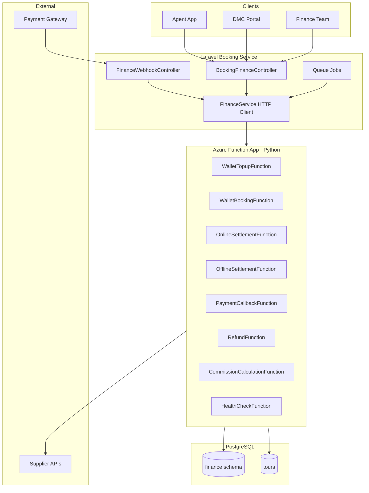

# Travclicks Finance Microservice

Production-grade finance microservice for the Travclicks B2B Travel Platform.

## Folder Structure

```
finance-microservice/
├── README.md
├── docs/
│   ├── SOFTWARE_DESIGN_DOCUMENT.md
│   └── API_SPECIFICATION.md
├── sql/
│   ├── 001_create_finance_schema.sql   # Creates finance tables in public schema
│   ├── 003_patch_existing_finance_schema.sql
│   └── 004_move_finance_schema_to_public.sql  # One-time move from finance schema
└── azure-functions/
    ├── function_app.py          # HTTP triggers (v2 model)
    ├── host.json
    ├── requirements.txt
    ├── local.settings.json.example
    └── shared/
        ├── auth.py              # Bearer + webhook HMAC + idempotency
        ├── callbacks.py         # Gateway callback processing
        ├── config.py
        ├── db.py                # PostgreSQL pool + transactions
        ├── logger.py
        ├── models.py            # Pydantic request/response models
        ├── payment.py
        ├── refund.py
        ├── settlement.py
        └── wallet.py

app/Services/Finance/             # Laravel integration
app/Http/Controllers/Api/         # BookingFinanceController, FinanceWebhookController
app/Jobs/                         # Retry + settlement timeout jobs
config/finance.php
database/migrations/              # Finance schema + tours columns
```

## Quick Start

### 1. Database

```bash
psql -U postgres -d dmc_dev -f finance-microservice/sql/001_create_finance_schema.sql
psql -U postgres -d dmc_dev -f finance-microservice/sql/002_alter_tours_finance_columns.sql

# If upgrading from an older deployment that used the `finance` schema:
psql -U postgres -d dmc_dev -f finance-microservice/sql/004_move_finance_schema_to_public.sql
```

Finance tables live in the **public** schema (`wallet`, `wallet_ledger`, `payment_transactions`, etc.).  
The legacy Laravel user-balance table is renamed to **`user_wallets`** to avoid a name clash.

Or via Laravel:

```bash
php artisan migrate
```

### 2. Azure Functions (local)

```bash
cd finance-microservice/azure-functions
cp local.settings.json.example local.settings.json
pip install -r requirements.txt
func start
```

### 3. Laravel `.env`

```env
FINANCE_SERVICE_BASE_URL=http://localhost:7071/api
FINANCE_API_BEARER_TOKEN=your-secure-bearer-token
FINANCE_WEBHOOK_SECRET=your-webhook-hmac-secret
FINANCE_HTTP_TIMEOUT=30
FINANCE_RETRY_MAX_ATTEMPTS=3
RAZORPAY_KEY_ID=
RAZORPAY_KEY_SECRET=
RAZORPAY_WEBHOOK_SECRET=
```

## Architecture



## Business Flow Summary

| Flow | Laravel Endpoint | Azure Function | Tables Hit |
|------|-----------------|----------------|------------|
| Wallet Top-up | `POST /api/v1/finance/wallet/topup` | `/wallet/topup` | wallet, wallet_ledger |
| Wallet Booking | `POST /api/v1/finance/wallet/booking` | `/wallet/booking` | wallet, payment_transactions, settlements, tours |
| Online Payment | `POST /api/v1/finance/payment/create` | Gateway + `/payment/callback` | payment_transactions, settlements, tours |
| Offline Settlement | `POST /api/v1/finance/settlement/offline` | `/settlement/offline` | payment_transactions, settlements, tours |
| Refund | `POST /api/v1/finance/refund` | `/refund` | settlements, wallet, tours |
| Commission | `POST /api/v1/finance/commission/calculate` | `/commission/calculate` | — (stateless) |

See [docs/SOFTWARE_DESIGN_DOCUMENT.md](docs/SOFTWARE_DESIGN_DOCUMENT.md) for full sequence diagrams and [docs/API_SPECIFICATION.md](docs/API_SPECIFICATION.md) for request/response JSON.
