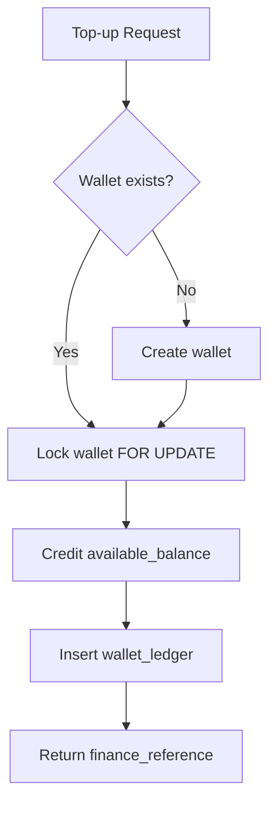
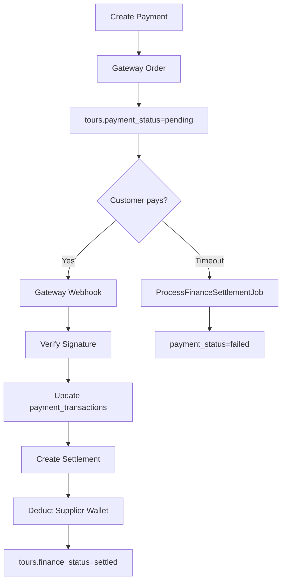
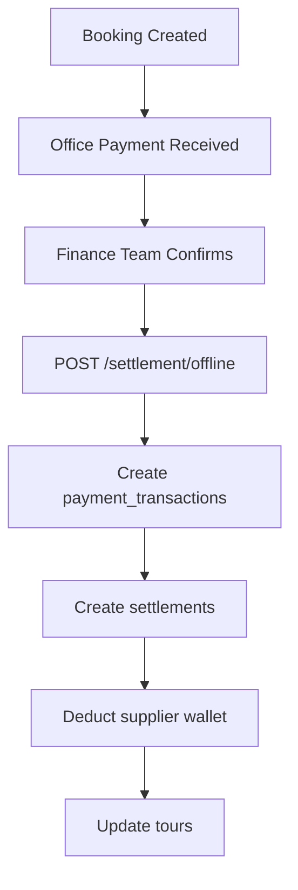
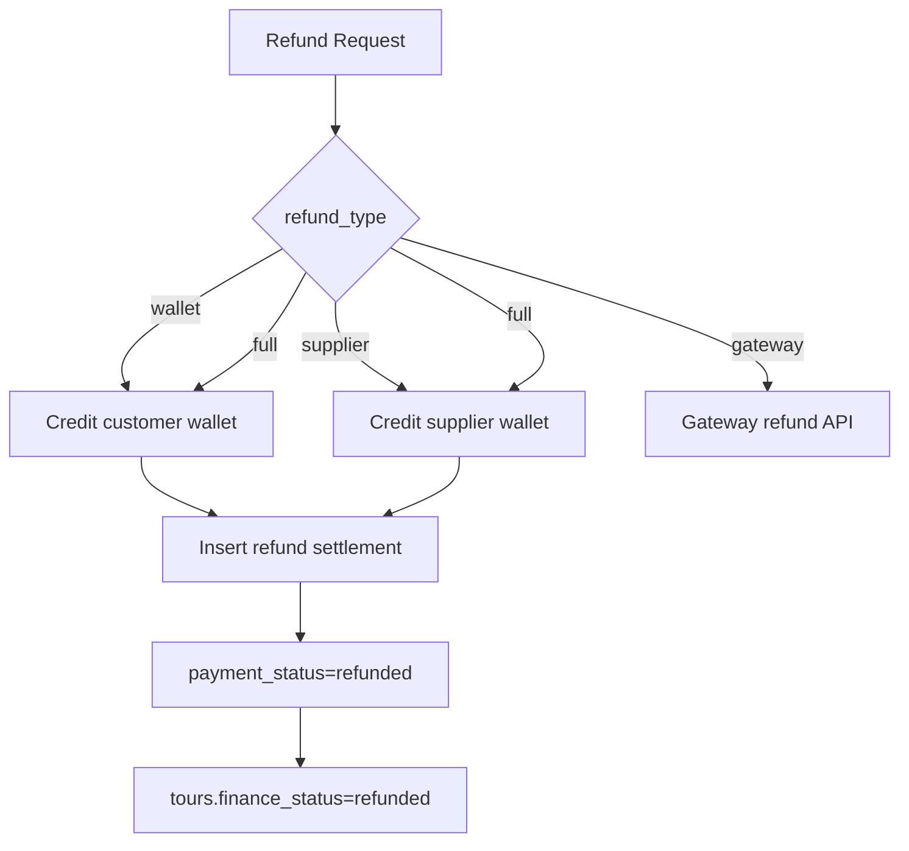
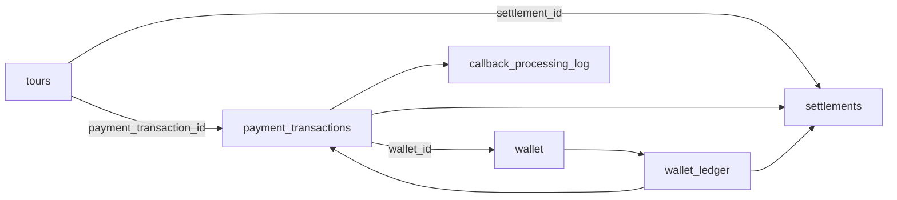

# Travclicks Finance Microservice — API Specification

**Base URL (Azure):** `https://{function-app}.azurewebsites.net/api`  
**Base URL (Laravel proxy):** `https://{app}/api/v1/finance`  
**Authentication:** `Authorization: Bearer {FINANCE_API_BEARER_TOKEN}`  
**Content-Type:** `application/json`

---

## Common Response Envelope

```json
{
  "success": true,
  "message": "OK",
  "data": { },
  "error_code": null
}
```

### Error Codes

| Code | HTTP | Description |
|------|------|-------------|
| `AUTH_ERROR` | 401 | Invalid or missing Bearer token |
| `VALIDATION_ERROR` | 400 | Request validation failed |
| `INSUFFICIENT_BALANCE` | 402 | Wallet balance too low |
| `BUSINESS_ERROR` | 422 | Business rule violation (refund, callback) |
| `CALLBACK_ERROR` | 422 | Callback processing failed |
| `INTERNAL_ERROR` | 500 | Unexpected server error |

---

## 1. Wallet Top-up

**Azure:** `POST /wallet/topup`  
**Laravel:** `POST /api/v1/finance/wallet/topup` (auth:sanctum)

### Request

```json
{
  "idempotency_key": "550e8400-e29b-41d4-a716-446655440000",
  "wallet_owner_type": "dmc",
  "wallet_owner_id": 42,
  "topup_amount": "5000.0000",
  "wallet_currency_code": "USD",
  "supplier_api_id": null,
  "ledger_description": "Monthly wallet recharge"
}
```

### Response `200`

```json
{
  "success": true,
  "message": "OK",
  "data": {
    "finance_reference": "FIN-20260708-100001",
    "wallet_uuid": "a1b2c3d4-e5f6-7890-abcd-ef1234567890",
    "available_balance": "15000.0000",
    "ledger_uuid": "b2c3d4e5-f6a7-8901-bcde-f12345678901"
  }
}
```

### Tables Updated

| Table | Operation | Columns |
|-------|-----------|---------|
| `wallet` | INSERT/UPDATE | `available_balance`, `total_credited` |
| `wallet_ledger` | INSERT | `credit_amount`, `balance_after`, `ledger_entry_type=topup` |

---

## 2. Wallet Booking

**Azure:** `POST /wallet/booking`  
**Laravel:** `POST /api/v1/finance/wallet/booking`

### Request

```json
{
  "idempotency_key": "booking-uuid-001",
  "tour_id": 9876,
  "wallet_owner_type": "dmc",
  "wallet_owner_id": 42,
  "supplier_api_id": "hotelbeds",
  "supplier_booking_reference": "HB-2026-998877",
  "supplier_cost": "100.0000",
  "travclicks_markup": "50.0000",
  "dmc_commission": "70.0000",
  "selling_price": "220.0000",
  "wallet_currency_code": "USD"
}
```

### Response `200`

```json
{
  "success": true,
  "message": "OK",
  "data": {
    "finance_reference": "FIN-20260708-100002",
    "payment_transaction_uuid": "c3d4e5f6-a7b8-9012-cdef-123456789012",
    "settlement_uuid": "d4e5f6a7-b8c9-0123-def0-234567890123",
    "settlement_status": "completed"
  }
}
```

### Response `402` — Insufficient Balance

```json
{
  "success": false,
  "message": "Insufficient wallet balance: available=50.0000, required=220.0000",
  "error_code": "INSUFFICIENT_BALANCE"
}
```

---

## 3. Online Settlement

**Azure:** `POST /settlement/online`  
**Laravel:** Called internally after payment callback

### Request

```json
{
  "idempotency_key": "settle-online-001",
  "tour_id": 9876,
  "payment_transaction_id": 12345,
  "gateway_transaction_reference": "pay_abc123xyz",
  "payment_gateway_name": "razorpay",
  "supplier_api_id": "hotelbeds",
  "supplier_booking_reference": "HB-2026-998877",
  "supplier_cost": "100.0000",
  "travclicks_markup": "50.0000",
  "dmc_commission": "70.0000",
  "selling_price": "220.0000",
  "payment_received_amount": "220.0000",
  "payment_received_currency": "USD",
  "gateway_response_json": { "status": "captured" }
}
```

### Response `200`

```json
{
  "success": true,
  "message": "OK",
  "data": {
    "settlement_uuid": "e5f6a7b8-c9d0-1234-ef01-345678901234",
    "settlement_reference": "SET-pay_abc123xyz",
    "settlement_status": "completed",
    "travclicks_profit": "50.0000",
    "dmc_profit": "70.0000"
  }
}
```

---

## 4. Offline Settlement

**Azure:** `POST /settlement/offline`  
**Laravel:** `POST /api/v1/finance/settlement/offline`

### Request

```json
{
  "idempotency_key": "offline-001",
  "tour_id": 9876,
  "finance_confirmed_by": "finance.manager@travclicks.com",
  "supplier_api_id": "hotelbeds",
  "supplier_cost": "100.0000",
  "travclicks_markup": "50.0000",
  "dmc_commission": "70.0000",
  "selling_price": "220.0000",
  "payment_received_amount": "220.0000",
  "payment_received_currency": "USD",
  "office_receipt_reference": "RCPT-2026-0042"
}
```

---

## 5. Payment Callback

**Azure:** `POST /payment/callback`  
**Laravel:** `POST /api/v1/finance/webhook/payment` (public, signature-verified)

### Headers

```
X-Gateway-Signature: sha256={hmac_hex}
```

### Request

```json
{
  "gateway_name": "razorpay",
  "transaction_id": "pay_abc123xyz",
  "status": "captured",
  "amount": 220.00,
  "currency": "USD",
  "merchant_reference": "FIN-20260708-100003"
}
```

### Response `200`

```json
{
  "success": true,
  "message": "Callback processed",
  "data": {
    "status": "captured",
    "gateway_transaction_reference": "pay_abc123xyz",
    "settlement_uuid": "f6a7b8c9-d0e1-2345-f012-456789012345",
    "settlement_status": "completed"
  }
}
```

---

## 6. Refund

**Azure:** `POST /refund`  
**Laravel:** `POST /api/v1/finance/refund`

### Request

```json
{
  "idempotency_key": "refund-001",
  "tour_id": 9876,
  "payment_transaction_id": 12345,
  "refund_type": "full",
  "refund_amount": "220.0000",
  "refund_currency_code": "USD",
  "refund_reason": "Customer cancellation",
  "wallet_owner_type": "dmc",
  "wallet_owner_id": 42
}
```

### Response `200`

```json
{
  "success": true,
  "message": "OK",
  "data": {
    "finance_reference": "REF-20260708-100010",
    "payment_transaction_uuid": "c3d4e5f6-a7b8-9012-cdef-123456789012",
    "payment_status": "refunded"
  }
}
```

---

## 7. Commission Calculation

**Azure:** `POST /commission/calculate`  
**Laravel:** `POST /api/v1/finance/commission/calculate`

### Request

```json
{
  "supplier_cost": "100.0000",
  "travclicks_markup_percent": "50.0000",
  "dmc_commission_percent": "46.6667",
  "agent_markup_percent": "0",
  "currency_code": "USD"
}
```

### Response `200`

```json
{
  "success": true,
  "message": "Commission calculated",
  "data": {
    "supplier_cost": "100.0000",
    "travclicks_markup": "50.0000",
    "travclicks_price": "150.0000",
    "dmc_commission": "70.0000",
    "selling_price": "220.0000",
    "travclicks_profit": "50.0000",
    "dmc_profit": "70.0000",
    "currency_code": "USD"
  }
}
```

---

## 8. Health Check

**Azure:** `GET /health` (no auth)

### Response `200`

```json
{
  "status": "healthy",
  "service": "finance-microservice",
  "database": "connected"
}
```

---

## 9. Webhook Verification

**Azure:** `POST /webhook/verify`

### Headers

```
X-Gateway-Signature: sha256={hmac_hex}
```

### Response `200` / `401`

```json
{
  "signature_verified": true,
  "message": "Signature valid"
}
```

---

## Laravel Integration Reference

### When Laravel Calls Azure

| User Action | Laravel Method | Azure Endpoint | Queue Job |
|-------------|---------------|----------------|-----------|
| DMC tops up wallet | `WalletService::topup()` | `/wallet/topup` | — |
| Agent books with wallet | `WalletService::bookWithWallet()` | `/wallet/booking` | `RetryFinanceOperationJob` on failure |
| Agent pays online | `PaymentGatewayService::createPayment()` | Gateway API | `ProcessFinanceSettlementJob` (timeout) |
| Gateway callback | `FinanceWebhookController` | `/payment/callback` | `RetryFinanceOperationJob` on failure |
| Finance confirms offline | `SettlementService::settleOffline()` | `/settlement/offline` | — |
| Cancellation refund | `PaymentGatewayService::refund()` | `/refund` | `RetryFinanceOperationJob` on failure |
| Price preview | `SettlementService::calculateCommission()` | `/commission/calculate` | — |

### Error Handling in Laravel

```php
try {
    $result = $this->walletService->bookWithWallet($validated);
    return response()->json($result);
} catch (RuntimeException $e) {
    if ($e->getCode() === 402) {
        return response()->json(['success' => false, 'message' => $e->getMessage()], 402);
    }
    RetryFinanceOperationJob::dispatch('wallet_booking', $validated)->delay(30);
    return response()->json(['success' => false, 'message' => $e->getMessage()], 500);
}
```

---

## Flow Diagrams

### Wallet Flow



### Online Payment Flow



### Offline Payment Flow



### Refund Flow



### Database Relationships


