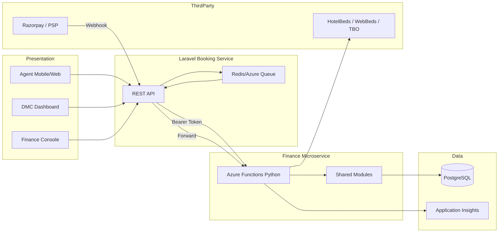
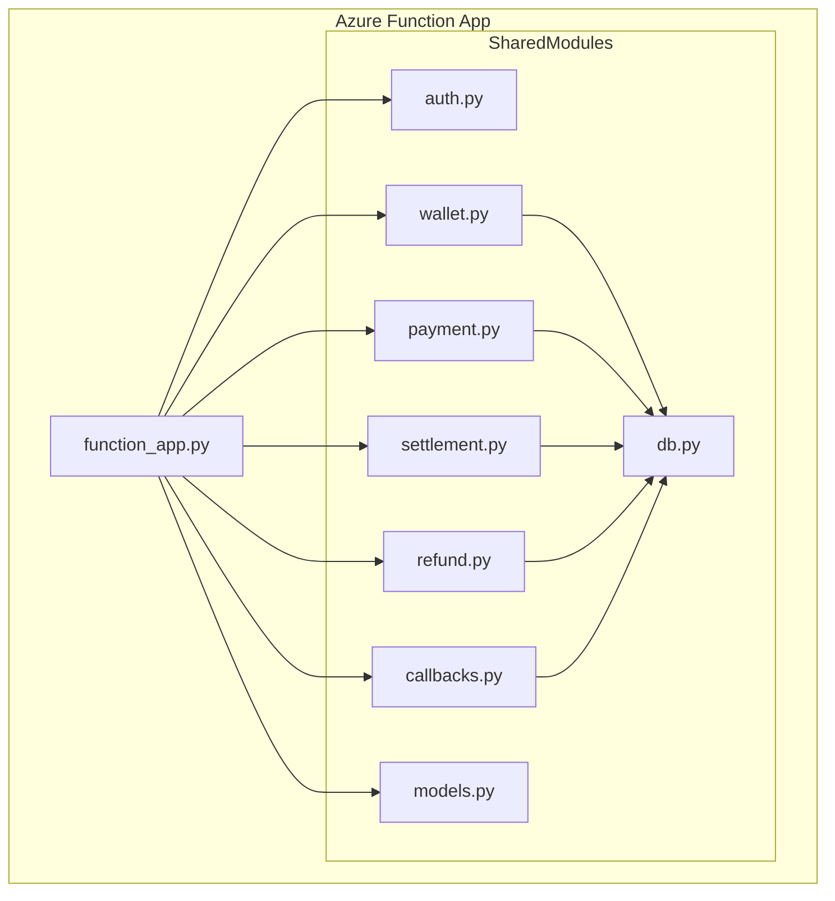
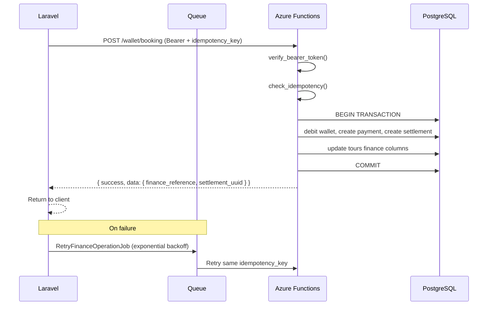
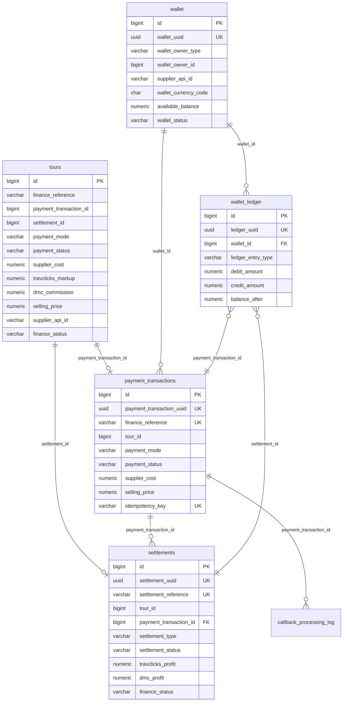
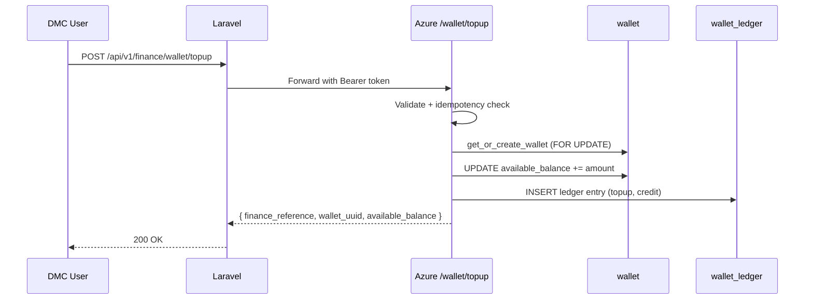
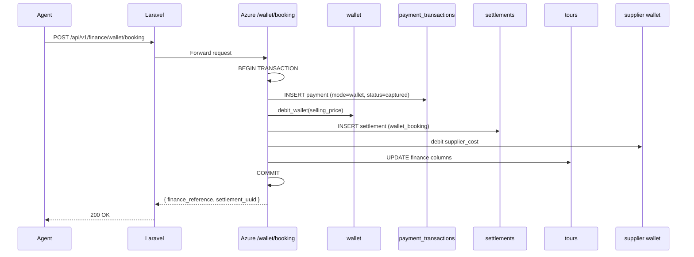
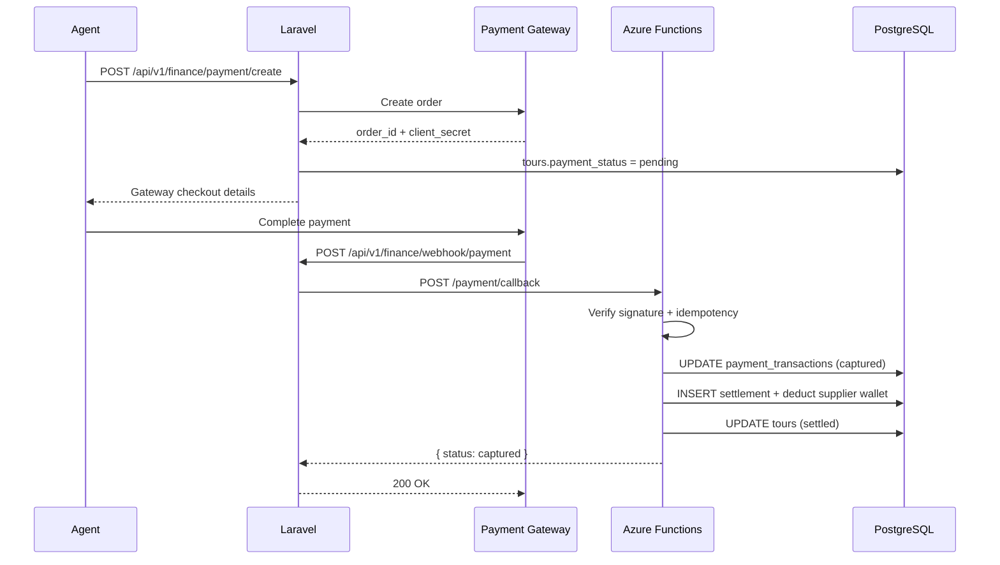
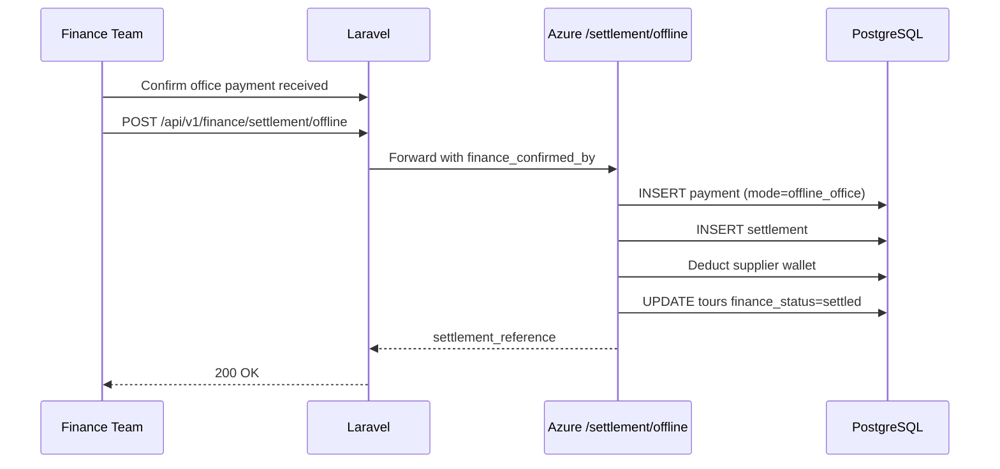
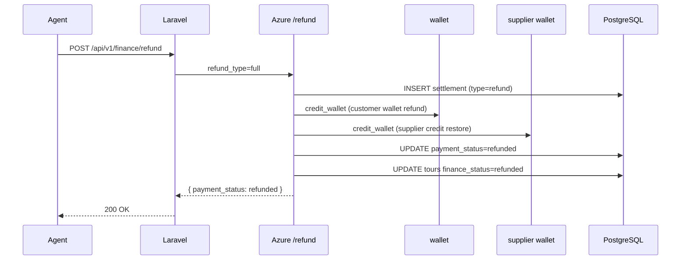

# Travclicks Finance Microservice — Software Design Document

**Version:** 1.0  
**Date:** 2026-07-08  
**Author:** Travclicks Engineering  
**Status:** Production Ready

---

## 1. Executive Summary

The Finance Microservice handles all monetary operations for the Travclicks B2B Travel Platform: wallet management, online/offline payments, supplier settlements, commission calculation, and refunds. It is implemented as an **Azure Function App (Python v2)** with a dedicated **`finance` PostgreSQL schema**, integrated into the existing Laravel booking service via HTTP.

**Why a separate microservice?**
- **Isolation:** Payment logic is security-sensitive and benefits from independent deployment and scaling.
- **Single source of truth:** All financial calculations live in one bounded context (DDD).
- **Technology fit:** Python Azure Functions provide serverless scaling for millions of booking events.
- **Auditability:** Immutable wallet ledger and idempotent APIs support compliance requirements.

**Pricing example (business rule):**

| Party | Amount |
|-------|--------|
| Supplier API cost | $100 |
| Travclicks markup | $50 |
| Travclicks price | $150 |
| DMC commission | $70 |
| Agent selling price | $220 |
| Supplier receives | $100 |
| Travclicks profit | $50 |
| DMC profit | $70 |

---

## 2. Architecture

### 2.1 High-Level Architecture

### 2.2 Azure Function Architecture

### 2.3 Laravel ↔ Azure Communication

---

## 3. Database Design

### 3.1 ER Diagram

### 3.2 Why `tours` Columns Were Added (Not Redesigned)

The existing `tours` table is owned by the booking service. Finance columns are **denormalized snapshots** for fast list/detail queries without cross-schema joins on every booking screen.

| Column | Type | Nullable | Purpose | Example |
|--------|------|----------|---------|---------|
| `finance_reference` | VARCHAR(64) | YES | Links to finance microservice operation | `FIN-20260708-100001` |
| `payment_transaction_id` | BIGINT | YES | FK to `payment_transactions.id` | `12345` |
| `settlement_id` | BIGINT | YES | FK to `settlements.id` | `6789` |
| `payment_mode` | VARCHAR(32) | YES | Payment channel | `wallet` |
| `payment_status` | VARCHAR(32) | YES | Payment lifecycle | `captured` |
| `gateway_transaction_reference` | VARCHAR(128) | YES | PSP transaction ID | `pay_abc123` |
| `gateway_response_json` | JSONB | YES | Create-payment API response | `{ "id": "order_xyz" }` |
| `supplier_cost` | NUMERIC(18,4) | YES | Net supplier price | `100.0000` |
| `travclicks_markup` | NUMERIC(18,4) | YES | Platform markup | `50.0000` |
| `dmc_commission` | NUMERIC(18,4) | YES | DMC profit component | `70.0000` |
| `selling_price` | NUMERIC(18,4) | YES | Agent-facing price | `220.0000` |
| `supplier_api_id` | VARCHAR(64) | YES | Supplier identifier | `hotelbeds` |
| `supplier_booking_reference` | VARCHAR(128) | YES | Supplier confirmation | `HB-2026-998877` |
| `finance_status` | VARCHAR(32) | YES | Settlement state | `settled` |
| `payment_received_amount` | NUMERIC(18,4) | YES | Actual received amount | `220.0000` |
| `payment_received_currency` | CHAR(3) | YES | ISO 4217 | `USD` |
| `payment_gateway_name` | VARCHAR(64) | YES | PSP name | `razorpay` |
| `payment_gateway_response` | JSONB | YES | Webhook/callback payload | `{ "status": "captured" }` |
| `payment_received_datetime` | TIMESTAMPTZ | YES | Payment confirmation time | `2026-07-08T10:30:00Z` |
| `master_dmc_id` | BIGINT | YES | Hierarchy routing | `5` |

**Source of truth:** public schema finance tables (`wallet`, `wallet_ledger`, `payment_transactions`, `settlements`). `tours` columns are updated by the microservice on every financial event.

---

## 4. Sequence Diagrams

### 4.1 Wallet Top-up

### 4.2 Wallet Booking

### 4.3 Online Payment Booking

### 4.4 Offline Booking

### 4.5 Refund

---

## 5. Business Rules

1. **Selling price validation:** `selling_price = supplier_cost + travclicks_markup + dmc_commission` (±$0.01 tolerance).
2. **Wallet debit:** Booking fails with HTTP 402 if `available_balance < selling_price`.
3. **Idempotency:** Same `idempotency_key` + operation returns cached response for 24 hours.
4. **Callback deduplication:** `callback_processing_log` unique on `(gateway_name, gateway_transaction_reference)`.
5. **Supplier wallet:** Travclicks maintains per-supplier API credit wallets; settlement debits `supplier_cost`.
6. **Atomicity:** All wallet + payment + settlement operations use PostgreSQL transactions with rollback on failure.

---

## 6. Deployment Architecture

### Azure Resources

| Resource | Purpose |
|----------|---------|
| Azure Function App (Python 3.11, Consumption/Premium) | Finance HTTP API |
| Azure Database for PostgreSQL Flexible Server | Shared DB with `finance` schema |
| Azure Key Vault | Bearer token, webhook secret, DB connection |
| Application Insights | Structured logging, alerts |
| Azure Storage Queue | Dead-letter for exhausted retries |
| Azure API Management (optional) | Rate limiting, WAF |

### Security

- **Laravel → Azure:** Bearer token (`FINANCE_API_BEARER_TOKEN`) via `Authorization: Bearer <token>`.
- **Gateway → Laravel:** HMAC-SHA256 signature (`X-Gateway-Signature`).
- **Database:** Connection string in Key Vault; finance schema restricted to function managed identity.

### Monitoring & Logging

- Structured JSON logs via `shared/logger.py`.
- Application Insights custom events: `wallet_topup_completed`, `callback_processed`, `refund_completed`.
- Alerts on: 5xx rate > 1%, callback processing lag > 5 min, wallet negative balance attempts.

### Retry Strategy

| Layer | Strategy |
|-------|----------|
| Azure Functions | Exponential backoff (host.json): 3 retries, 2s–30s |
| Laravel Queue | `RetryFinanceOperationJob`: 10s, 60s, 300s backoff |
| Idempotency | Same key prevents duplicate financial side-effects |

### Performance & Scalability

- Connection pool: 1–20 connections per function instance.
- Indexed columns on `tour_id`, `gateway_transaction_reference`, `finance_reference`.
- Horizontal scaling: Azure Functions auto-scale on HTTP queue depth.
- Target: 10,000 settlements/minute at Premium plan with read replicas.

### Backup & Disaster Recovery

- PostgreSQL: Point-in-time recovery (35 days), geo-redundant backup.
- `wallet_ledger` is append-only — never deleted, supports forensic audit.
- RTO: 1 hour, RPO: 5 minutes.

---

## 7. Future Enhancements

- Multi-currency FX conversion at settlement time.
- Event-driven architecture via Azure Service Bus (booking.created → auto-settle).
- Real-time finance dashboard with read replicas.
- Stripe/Adyen gateway adapters.
- Automated supplier reconciliation batch jobs.
